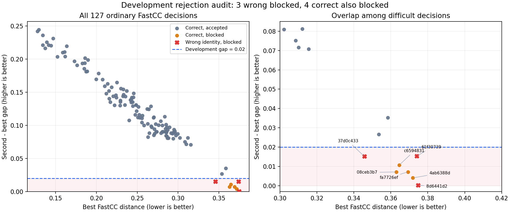

# Opt-in rejection for the Pi demo — 2026-10-30

The demo previously instantiated `Gallery(threshold=1.0, min_margin=0)`, so a nearest identity was normally returned even when uncertain. `Gallery` already had ordinary distance/margin gates, but the staged matcher can return ordinary FastCC, angular CompNet or response-weighted distances. Applying one nominal threshold silently across those families is inappropriate.

## Implementation

`acceptance_policy.py` validates an explicit versioned runtime policy. `DemoFlow` reads `runtime/demo_acceptance_policy.json` at startup; absent file preserves the old ranking-only mode. When enabled, `Gallery` applies the policy **after** the matcher produces its original ranking. Ordinary FastCC, angular CompNet and weighted quality each have their own profile. Unknown routes or a missing family profile cause RETRY; they cannot borrow another metric's thresholds. This implementation targets the explicitly listed staged matcher routes; a different matcher must have its score family established before enabling the file.

Each profile has a maximum best distance and minimum first/second margin. Bad distance gives UNKNOWN, ambiguous/tied scores or a missing second candidate give RETRY. Neither outcome contains an identity or payment token. The policy never converts rejection into a true identification, never changes feature extraction, registration, scores, early-return gates or labels, and never fits thresholds online. Every gallery now rejects non-finite scores even without the opt-in policy. Malformed policy files fail startup instead of silently disabling rejection.

`DemoFlow.identify` clears old pending tokens before capture, so an older MATCH cannot be confirmed after a new rejected attempt. The existing UI already handles UNKNOWN/RETRY with no payment action. These behaviors are exercised by integration tests, including attempted confirmation of an old token after rejection and balances/transaction invariance.

## Fixed development operating points

Four margins were examined: .01, .02, .04 and .08 for ordinary FastCC. Its max distance remains 1.0 in this **margin-only experiment**, so it is not a calibrated absolute stranger-distance gate. CompNet and weighted quality each keep the existing .32/.08 confidence limits in separate profiles; equality of these nominal numbers is inherited from their existing routing, not evidence that the distance distributions are interchangeable or calibrated for unknown people.

The exact saved retained-evidence **168-query** ranking results were passed through the same new policy code. No ROI/feature replay is necessary to compute this pure post-ranking table. The code asserts no new identities and tracks lost correct decisions separately. These are development operating points examined after exposure to the cohort, not an independent validation set or a claim of unseen-person false-accept rate.

| FastCC minimum gap | Correct accept | Wrong accept | RETRY/reject | Previously correct lost |
|---|---:|---:|---:|---:|
| Off (retained-evidence reference) | 165 | 3 | 0 | 0 |
| .01 | 162 | 2 | 4 | 3 |
| .02 | **161** | **0** | **7** | **4** |
| .04 | 159 | 0 | 9 | 6 |
| .08 | 156 | 0 | 12 | 9 |

The .02 example turns the three remaining wrong identities into RETRY, not correct identifications. Correct recognition falls from **165/168 (98.21%) to 161/168 (95.83%)**; four of the 165 previously correct decisions are lost (2.42%). Seven total attempts are rejected (4.17%). Accepted-only correctness must not conceal these lost correct recognitions. Zero wrong accept in this small, previously exposed cohort is not a zero-FAR claim.

The four falsely rejected correct queries are:

| Case | Suffix | Best distance | Gap |
|---|---|---:|---:|
| New camera reverse | 08ceb3b7 | .3630202140 | .0071599775 |
| Old camera original | 4ab6388d | .3719086022 | .0040679603 |
| Old camera original | c6594831 | .3644993280 | .0106581821 |
| Old camera reverse | fa7726ef | .3692818409 | .0071830028 |

Wrong suffix `37d0c433` has distance **.3457031250** and gap **.0151682208**. It has both a lower (apparently better) distance and a larger (apparently clearer) margin than each of those four correct cases. Therefore any common monotone maximum-distance/minimum-margin acceptance rectangle that rejects this wrong case must also reject those four correct points. More threshold searching cannot remove that particular ambiguity while retaining them all. Richer image/identity evidence is needed to improve this tradeoff.

The earlier geometric-support rejection rule remains rejected: it falsely blocked eight originally correct exhaustive decisions and was not adopted as this mechanism.

## Accuracy improvements versus threshold calibration

The user's constraint is to allow modest threshold calibration while **not relying on threshold changes as the main fix**. The .01/.02/.04/.08 rows are diagnostic sensitivity results; none was selected as the production default. This post-ranking layer does not improve genuine recognition: the .02 point loses four correct results while converting three errors to RETRY. It must not replace the primary goal of improving ROI, correspondence/registration and identity evidence so difficult queries become correct MATCHes.

For subsequent algorithm candidates, first hold the scoring acceptance policy fixed and measure genuine wrong-to-correct changes alongside correct-to-wrong and correct-to-rejected losses. Report algorithm gains separately from any later small threshold calibration. If calibration is justified, declare a limited range and the score family before testing, use development/calibration data only, and lock the resulting policy before a separate evaluation. Do not widen the search until familiar failures disappear, make person/image exceptions, or tune on the new 17 removal queries now that their outcomes are known. Unknown-person errors, all rejected correct queries and timing tails remain visible.

Future evidence-consistency or quality rules also require this accounting; calling a rule structural does not guarantee generalization. Previously rejected geometric-support rules demonstrate that risk. Independent people/sessions and realistic gallery size are needed to assess whether a new rule improves the tradeoff.

The plot excludes the 36 angular and five weighted-score decisions rather than mixing their scales. Red crosses are the three wrong identities; orange points are correct identities blocked by the .02 margin. The lower shaded area is rejected. This is the same saved-score audit, not additional independent observations.

## Actual HTTP validation protocol

Use an isolated source override and copied runtime, preserving both production and the frozen v26 APP directory. Install the same retained-evidence helper as the full168 reference. The development .02 profile is fixed before this HTTP run and is not adjusted after its outcomes.

Known selection: all 13 frozen exhaustive queries plus one fixed fast correct control per case (17). Recompute original images/ROIs/features, assert every whole-gallery score and best/second/route equals the saved retained-evidence reference, then assert actual HTTP status/reason equals the new policy. Rejected requests must have neither identity nor pending token; an invalid confirmation must fail and accounts must remain unchanged.

Unknown diagnostic selection: for every physical person in each **original-split** gallery, remove all of that person's palm labels before fresh matcher/index initialization, then query the lexicographically first image of each removed palm label. Aliases come from the frozen protocol. This gives nine fresh removal galleries, covering all seven people across their available device galleries, and 17 unknown attempts. No original templates are deleted: isolated galleries link only retained files. Both hands of each person are excluded together. No full-gallery index survives a removal. All planned samples are fixed before the first request.

This is a leave-person-out **gallery-removal diagnostic** on development images already seen by the project, not independently collected strangers or model-training subject holdout. Historical v26 pseudo-unknown scores are reported separately and must not be relabeled as current retained-evidence HTTP outcomes. Abort on any nonzero/unreadable Pi throttle flag. No camera capture or external upload is measured. Post-ranking rejection does not accelerate feature extraction or long-tail matching.

## Completed actual HTTP results

All **34 planned original-image HTTP queries** completed: 17 known plus 17 person-removed. All known queries exactly preserved the reference whole-gallery scores, best/second scores and route, with actual final status/reason matching the policy audit. They produced **10 correct MATCH, zero wrong MATCH and seven RETRY**; those seven are the three remaining wrong identities and four previously correct queries. The other 151 full-cohort decisions are represented by the deterministic saved-score audit, not falsely reported as 151 new image requests.

The unknown diagnostic used all nine planned fresh removal galleries and produced **16 RETRY, one wrong MATCH out of 17**. This larger selection exposes a failure absent from the older six-query pseudo-unknown selection: suffix `18397071`, old bankey right, was accepted as old stephen right after **both bankey labels had been excluded**. Its ordinary FastCC best score is .34554561491935487, second is .37451171875, gap .02896610383064513, route `exhaustive_retained_fastcc_pilot`, HTTP 6878.21ms. The failure is retained and the .02 profile was not adjusted after observing it.

All 23 rejected requests (seven known, 16 unknown) had no identity or payment token, no pending token, and rejected a confirmation attempt. All copied account transaction counts remained unchanged. All source template hashes were unchanged. All **70 power checkpoints** were `throttled=0x0`. Production and frozen APP were not modified; only an isolated source override loaded the changed gateway files.

Applying the **same four already-declared margin points** to the recorded removal-query scores gives:

| Gap | Known correct /168 | Known wrong /168 | Known rejected /168 | Unknown rejected /17 | Unknown wrongly accepted /17 |
|---|---:|---:|---:|---:|---:|
| .01 | 162 | 2 | 4 | 14 | 3 |
| .02 | 161 | 0 | 7 | 16 | 1 |
| .04 | 159 | 0 | 9 | 17 | 0 |
| .08 | 156 | 0 | 12 | 17 | 0 |

Only **.02** was installed as the actual HTTP policy during the 34-query run. The other rows are pure post-ranking calculations on the same fixed scores, not additional HTTP runs, independent trials or a basis for automatically selecting the best-looking threshold. In particular .04 loses **six** of the 165 previously correct decisions. .08 loses nine, without an additional rejection benefit in this small removal selection.

The implementation is usable as an experimental rejection layer, but the .02 example is not a reliable unknown-person classifier and is not enabled in production. The source still defaults to the explicitly documented ranking mode if the file is absent. Next calibration needs new device captures of both enrolled palms and people entirely absent from the gallery, with fixed thresholds before inspection and a separate final evaluation set. Gallery size must be representative of the planned roughly 40 people: larger galleries change the nearest competing score and rejection tradeoff. This seven-person, 17-palm development cohort does not establish that operating point. Richer localization/representation evidence is still needed to retain difficult true matches.

Actual source hashes, all 34 scalar outcomes (including the leaked unknown), and separation of HTTP versus saved-score scope: [REJECTION_POLICY_HTTP_20261030.json](protocols/REJECTION_POLICY_HTTP_20261030.json), generated by `tools/report_rejection_http.py`. Relevant local policy/gallery/workflow/ROI integration tests: **47 passed**. No camera, live enrollment, production deployment or speed improvement is claimed by this run.

## Files and activation

- `acceptance_policy.py`: policy validation and metric-aware rejection.
- `tools/audit_rejection_policy.py`: reproducible saved-score audit.
- `tools/evaluate_rejection_policy.py`: actual known/removed-person HTTP validation.
- [REJECTION_POLICY_AUDIT_20261030.json](protocols/REJECTION_POLICY_AUDIT_20261030.json): scalar full168 audit and source hashes.
- [DEVELOPMENT_REJECTION_POLICY_20261030.json](protocols/DEVELOPMENT_REJECTION_POLICY_20261030.json): **experimental .02 example**, not a calibrated recommended default.
- [REJECTION_POLICY_HTTP_20261030.json](protocols/REJECTION_POLICY_HTTP_20261030.json): actual HTTP validation and the preserved unknown failure.

To opt in, supply a separately validated policy to the intended runtime as `demo_acceptance_policy.json` and restart that service. The committed development .02 file reproduces this experiment and is not a recommended deployment configuration. Remove the runtime file and restart to return to ranking-only behavior. The policy is independent of the retained-evidence repair: reproducing the table requires that repair's identical scoring reference, not an older production matcher. The committed example is not copied into production by this experiment. A one-candidate gallery cannot supply a margin and is intentionally rejected under this mechanism.
