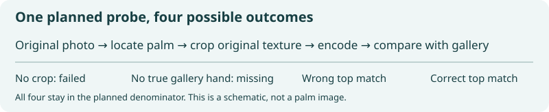
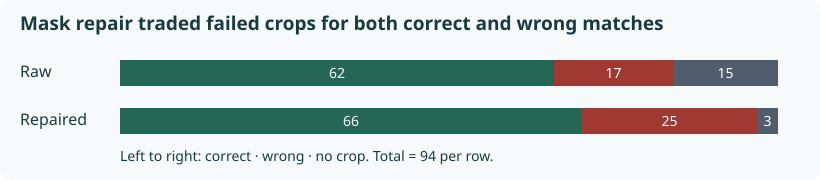

# 18 November 2026 | Palm recognition across cameras, poses and people

[Detailed experimental ledger: 17 result tables, denominators and interpretation](2026-11-18-experimental-results.md).

**Decision.** Keep the original-image recognition path. Returning more crops can increase both correct and wrong matches. Fixing a coordinate error produced a measurable improvement in a controlled comparison; a lower learning rate improved scratch training on development data. Neither is evidence of readiness for a new device or user.

This report traces one question through the project: **what prevents a second photograph of a hand from being matched to its enrollment?** A background mask can remove finger landmarks, a shifted crop can omit the texture seen at enrollment, and even a valid crop can be assigned to the wrong hand. Each problem needs a different test.

## Dataset inventory and evaluation roles

Counts distinguish what was available locally from what actually entered a comparison. A public collection name is not an assurance that the whole collection was used or that it is independent of training.

| Source | Why it matters | Inventory or test population |
| --- | --- | --- |
| 11K Hands and Public99 | Light backgrounds, palm vs back of hand, protocol construction | 2,755 locally expanded photos in the source report; the palm-side cohort had 2,641 images. Public99 is locally derived from 11K material, not an independent second population. |
| Axon | Multiple phone cameras, backgrounds, hand sides and poses | 469 local files including duplicates, not the publisher's full collection. A file count is not a person count. |
| BJTU PalmV2 | Test recognition from supplied crops without conflating localization failures | 1,641 available author-cropped ROIs; the cross-stage comparison below used 400 probes. |
| BMPD and SMPD | Session change, rotation and perspective on smartphones | 1,612 available BMPD originals (two hands, dark background) and 3,677 SMPD originals (several views of the right hand). |
| TCD / Tongji | Compare enrollment and query across capture sessions | The reported cross-session PKLNet comparisons retained 5,877 rankable probes. Other crops retained different numbers. |
| MPD/PalmSet, X-Palm and self-captures | Multiple phones and backgrounds, wide poses, practical failure modes | The detailed full-denominator and paired rows below identify the specific cohorts used. |

## From detection to a decision

A **reference/author crop** bypasses some localization failures. **PKLNet-v5** estimates a palm region from the input. The **21-point letterbox** route predicts landmarks in a resized and padded frame; the **five-view RTM** route can try different views before transforming the points back to the original image. The white-background method changes the localization input only: texture for recognition always comes from the original photo.

PalmBridge, SF2Net and PPNet are recognizers rather than region finders: they encode a cropped patch and compare it to the enrollment gallery. A **rank-1** result asks who ranks first. A **threshold** decides whether a proposed match is strong enough to accept. A wrong top match and a wrong accepted match are not the same event. **EER** is the measured intersection of false acceptance and false rejection when sweeping a threshold over score pairs; it is not a ready-to-use security setting.

### Historical cross-dataset baseline grid

Each cell gives correct / **rankable** probes, then EER. These denominators are not necessarily all originally planned queries. Different gallery membership and crop failures also change the population of genuine and impostor comparisons.

| Dataset and condition | PalmBridge | SF2Net | PPNet |
| --- | --- | --- | --- |
| BJTU, author crops, cross-stage | 366/400; 7.40% | 380/400; 8.00% | 327/400; 9.38% |
| TCD, PKLNet crop, cross-session | 5,281/5,877; 2.98% | 5,800/5,877; 1.63% | Not on this shared setup |
| TCD, five-view RTM crop, cross-session | 4,465/5,998; 11.49% | 3,685/5,998; 23.25% | Not reported |
| SMPD, five-view RTM, five gallery images per hand | 248/2,568; 42.63% | 124/2,568; 45.29% | 235/2,568; 45.33% |

On BJTU, SF2 led PB on top-1 count but not on EER: one is a ranking and the other a threshold sweep. In TCD, the different denominators rule out attributing the entire gap to geometry. The following paired experiments were designed to address that limitation.

## Paired comparisons: which stage loses the hand?

The task is to find the correct enrolled hand from a photograph. A **region of interest (ROI)** is the patch of original palm texture sent to a recognizer. The recognizer produces a vector; its nearest enrolled vector gives a proposed identity. The **gallery** contains enrollment images; a **probe** is a query. If the camera pipeline returns no usable crop, or the correct hand is absent from the gallery, the user still did not get a correct answer. We therefore report correct matches over the number of queries originally planned, not just over successful crops.

## Data used, and what each comparison can tell us

| Data and role | Scale and comparison | Finding and limitation |
| --- | --- | --- |
| MPD/PalmSet: localization and full-gallery recognition | 200 people; 16,000 images. A common plan reserved 800 enrollments and 15,200 queries. Only 771 enrollment images were usable, representing 395/400 hand classes. | On identical gray 128px crops, FlowPalm's filtering encoder identified 10,321/15,200, PalmBridge 9,675/15,200 and SF2Net 10,396/15,200. The query denominator retains 561 missing probe ROIs and 161 cases without the correct gallery class. FlowPalm here means the MobileFaceNet filtering encoder, not the synthetic generator. |
| MPD: controlled geometry/pixel comparison | 252 planned probes on a smaller previously examined panel, 35 common enrollments. Keep gallery and recognition model fixed; vary the geometry or the pixels. | For original RGB at 224px, RTM vs PKL geometry gave 224 vs 184 correct (Flow), 207 vs 186 (PalmBridge), and 209 vs 176 (SF2Net). Holding RTM geometry fixed but using grayscale 128px gave 204, 177 and 208 respectively. Geometry mattered across all three; changing the pixel input had unequal effects. |
| BMPD: coordinate repair | Across 1,612 images, compare RTM, PKLNet and the corrected D283 mapping on 802 planned known queries. | D283 produced 1,606 crops. With PalmBridge it gave 755/802 correct vs RTM's 745/802; with SF2Net, 740 vs 724. Gallery coverage is detailed below. |
| X-Palm: difficult phone views | The 17 November localization pilot contained 12 images across six conditions (two each: close, far, pitch, roll, text, wet). A separate official-code protocol used 38 gallery and 38 probe images. | Original-image localization and encoding succeeded on 12/12 pilot images; locating on a white background then cropping the original succeeded on 11/12. The one missing case was at far distance. No default switch on that evidence. This is **not** a 12/12 recognition result, nor is it the official-code benchmark. |
| Project captures: difficult environments | Keep all 94 known queries, separately track a deliberately difficult 40-case subset. | With SF2Net, raw processing yielded 62 correct / 17 wrong / 15 failed; mask repair gave 66 / 25 / 3. Four additional correct matches came with eight additional wrong ones. Reducing null outputs is not a sufficient success criterion. |

**Exposure matters.** PalmBridge and SF2Net training used 160 MPD people, with another 20 used in development. In the remaining 20-person slice, against the same large gallery, PalmBridge gave 405/1,520, SF2Net 747/1,520 and the Flow filter 1,019/1,520. The external encoder's training exposure is unknown. Consequently neither the full-cohort ordering nor this subset establishes an independent model winner. Rank-1 measures the best candidate, not whether to accept a stranger.

## Ideas we stopped or kept conditional

- **White-background localization:** It sometimes finds more regions but can also lose a far hand; recognition must use original texture. Keep both localization failure and downstream identity outcomes.
- **Force a crop in difficult scenes:** The directed semantic-region design returned a crop on all 94 self-capture probes, but only 48 were correct, versus 68 correct with RTM + PalmBridge. The difficult subset gave 4/40. A plausible-looking region is not necessarily a discriminative palm patch.
- **Change the recognizer before auditing the crop:** The paired geometry experiment above shows why this can be misleading: holding the model fixed, moving the crop changes dozens of answers. Compare geometry on a common gallery before crediting architecture changes.
- **Treat a different dataset as unseen by default:** Reject this shortcut. Mark known training/development exposure, person overlap, coverage and unknown author provenance separately.

**Next decision:** freeze coordinate transforms, enrollment roles and scoring before comparing alternative ROIs. Reserve fresh people and devices for the eventual operational test; measure failures, wrong identities, unknown-hand rejections and latency on actual hardware.

Evidence: 17 November localization pilot; 18 November full-200 shared-gallery aggregate, paired geometry/pixel 252-probe aggregate, D283 supervisor decision report, and difficult-scene paired handoff. No sample-level files accompany this report.

## Coordinate repair and difficult scenes

**Status through 18 November.** A square-view padding inversion used the wrong sign. In one historical Public99 candidate, 115 of 2,632 successful crops were affected. Old geometry-derived scores cannot be carried forward just because an image was successfully cropped. The RTM and PKLNet reference paths were unaffected by this particular bug.

**BMPD replay (D283).** The corrected geometry was fitted using 1,600 D173 point sets. On 1,612 BMPD inputs it returned 1,606 crops; six were unavailable. Out of 802 planned known queries (790 rankable in both corrected and RTM arms), PB placed the correct hand first 755 times versus 745 for RTM; SF2 gave 740 versus 724. The PKLNet arm had only 381 rankable queries and 41/81 complete gallery hands, so comparing conditional percentages alone would be misleading. These offline development comparisons do not establish performance on new users or on Pi hardware.

**Self-capture and challenge sets.** On the same 94 known self-capture queries, a segmentation repair changed SF2 from 62 correct / 17 wrong / 15 failed (raw) to 66 / 25 / 3. The number of wrong matches rose as failures fell. The directed-region alternative gave 48 correct / 46 wrong / 0 failed; the existing RTM + PB path gave 68 / 20 / 6. On 40 particularly difficult cases the directed method gave only 4 correct. Do not silently substitute a guess for a failed crop.

## Training on the crops used by the target pipeline

On 12 November the team trained PalmBridge from scratch on **1,854 successful automatic-ROI X-Palm training rows**; 109 unusable training rows were recorded separately. Development had 158 gallery images, 140 known probes and 109 unknown probes. Five ROI failures in each role stayed visible. This is different from the 38-probe author-code experiment.

With the same 140 planned known probes, the reference checkpoint gave 68 correct. The new model gave 72 at epoch 5, 89 at epoch 35 and 77 at epoch 100. Training accuracy approached 100% without a steady increase in development matches. That justified investigating crop alignment and checkpoint selection on development data, **not** claiming an independent test improvement. Earlier source-mixed training snapshots also used development-only checkpoint selection; percentages from those different protocols should not be pooled.

## Training and reproducing a published comparison

A useful crop does not by itself make a recognizer. We trained a small residual network to map images of the same hand near one another, and images of different hands farther apart. The angular-margin classifier (ArcFace) is used during training; at evaluation the classifier is removed and the system compares feature vectors against a gallery by cosine similarity. Left and right hands are separate classes, but both must stay on the same side of a **person-level** split.

## Experiment A: a locally trained residual encoder

The [Diff-Palm paper](https://arxiv.org/abs/2503.18312) motivated testing a modified residual-18 encoder. The paper uses synthetic training data and a different training budget. Our implementation uses real MPD images and locally defined training and evaluation; it is **not** a reproduction of the paper. We trained from scratch rather than quietly inheriting an encoder that may already have seen the evaluation people.

The main split used 100 people for training (1,590 usable crops), 24 other people for validation (383 crops) and 18 different, previously inspected people for evaluation (36 planned enrollments, 252 planned queries). Training and validation used manual-mark ROIs, whereas evaluation used automatic crops. That mismatch and the small amount of training data limit interpretation. All arms used 112px RGB, 512-component features, a 20-epoch schedule and matched starting conditions. The validation-selected checkpoint and last checkpoint are shown separately: choosing between them after looking at test scores would leak test information.

| Training intervention | Correct / planned at validation-selected checkpoint | Correct / planned at epoch 20 |
| --- | ---: | ---: |
| No augmentation | 14/252 (epoch 4) | 19/252 |
| Random geometric warps | 12/252 (epoch 3) | 16/252 |
| Loss-adversarial augmentation | 13/252 (epoch 12) | 12/252 |

All arms retained eight failed probes in the denominator. None supported promoting the scratch model or claiming that augmentation fixed generalization. [Implementation and synthetic walkthrough](../../research_code/README.md).

## Experiment B: isolate optimization from recognition

Did the poor result mean the model architecture was wrong, or was it failing to learn under this schedule? A separate lower-cost diagnostic used 80 training people and 20 validation people. We held the model and eight-epoch budget fixed and reduced the learning rate from 0.025 to 0.0025. On **280 validation probes**, the correct count rose from 30 to 174 in one initialization, and from 25 to 160 in a second seed. Changing update size had a large effect under this budget. These are development comparisons, **not** the 252-query evaluation, X-Palm scores, or evidence of performance on new users. Next: lock an optimization recipe without consulting the final panel, then test it once on untouched people.

## Experiment C: distinguish an author-code benchmark from a pose pilot

We ran the published X-Palm CompNet split and runner for SF/roll, separate from the small pose development tests. The held-out hand had one SF and one roll capture, assigned to gallery vs probe by the split. Training used **3,768 images and 152 hand classes**; the comparison has **38 gallery images, 38 probes, 38 genuine and 1,406 impostor comparisons**. Twenty-two people occur on both sides because the split unit is the hand; it is not person-disjoint. A public-paper mean across three runs is not directly comparable to one seed.

| Single-seed output | Rank-1 | Equal error rate (EER) |
| --- | ---: | ---: |
| Untrained initialization | 2/38 | 47.37% |
| Final audited score file | 3/38 | 34.71% |

EER is where false acceptance and false rejection rates meet when sweeping a threshold. It is not a threshold ready for use. The source chooses the checkpoint by test EER; source defaults were 128px/batch 128 rather than the appendix's 112px/batch 64. The local audit recomputed final results from the score file. This first seed did not match the paper's reported three-run mean (rank-1 24.56%, EER 23.77%). Differences in protocol or seeds are possible explanations, not demonstrated causes.

Evidence: matched 100-person training logs and aggregate best/last receipts; original and independent-seed 80/20 validation diagnostics; X-Palm author snapshot fe6ccc55, split receipt, final GPU log and independent score-file check, all dated 18 November. No third-party model source, test scores per individual, image cache or trained weights are redistributed.

## What to do next

1. Freeze the coordinate and preprocessing contract. Test synthetic landmark cases before rerunning affected real crops; retain failures in the denominator.
2. Compare candidates using the same enrolled hands and queries. Separate wrong top matches from wrong accepted matches. Report unknown-hand decisions separately.
3. Lock training choices without reviewing final-test outcomes. The learning-rate finding is a hypothesis for a new cohort, not a new population estimate.
4. Test video as an acquisition method against a single still on the same attempts, tracking wrong IDs, missed crops and time per decision. No video improvement has yet been demonstrated here.

**Source note.** The historical inventory and selected cross-dataset matrix use the project's supplied experiment report. The training trajectory uses the 12 November automatic-ROI training record. The paired comparisons, coordinate audit, and author-run results use the dated 16–18 November project records. Illustrations are schematics or aggregate counts; no participant photographs, identity mappings or individual score files are republished.

**Follow-up on the author-code comparison:** The subsequent three-seed audit gave mean rank-1 12.28% and EER 36.56% (paper: 24.56%, 23.77%). The earlier single-seed row above remains a run-specific result. See [table 13 and the evaluation caveats](2026-11-18-experimental-results.md).
