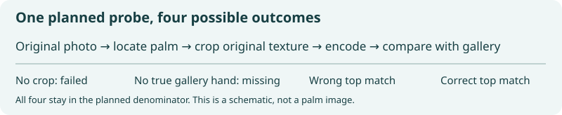
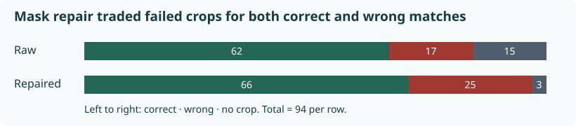

# 18 November 2026 | Where does the pipeline lose a hand?

The task is to find the correct enrolled hand from a photograph. A **region of interest (ROI)** is the patch of original palm texture sent to a recognizer. The recognizer produces a vector; its nearest enrolled vector gives a proposed identity. The **gallery** contains enrollment images; a **probe** is a query. If the camera pipeline returns no usable crop, or the correct hand is absent from the gallery, the user still did not get a correct answer. We therefore report correct matches over the number of queries originally planned, not just over successful crops.

## Data used, and what each comparison can tell us

| Data and role | Scale and comparison | Finding and limitation |
| --- | --- | --- |
| MPD/PalmSet: localization and full-gallery recognition | 200 people; 16,000 images. A common plan reserved 800 enrollments and 15,200 queries. Only 771 enrollment images were usable, representing 395/400 hand classes. | On identical gray 128px crops, FlowPalm's filtering encoder identified 10,321/15,200, PalmBridge 9,675/15,200 and SF2Net 10,396/15,200. The query denominator retains 561 missing probe ROIs and 161 cases without the correct gallery class. FlowPalm here means the MobileFaceNet filtering encoder, not the synthetic generator. |
| MPD: controlled geometry/pixel comparison | 252 planned probes on a smaller previously examined panel, 35 common enrollments. Keep gallery and recognition model fixed; vary the geometry or the pixels. | For original RGB at 224px, RTM vs PKL geometry gave 224 vs 184 correct (Flow), 207 vs 186 (PalmBridge), and 209 vs 176 (SF2Net). Holding RTM geometry fixed but using grayscale 128px gave 204, 177 and 208 respectively. Geometry mattered across all three; changing the pixel input had unequal effects. |
| BMPD: coordinate repair | Across 1,612 images, compare RTM, PKLNet and the corrected D283 mapping on 802 planned known queries. | D283 produced 1,606 crops. With PalmBridge it gave 755/802 correct vs RTM's 745/802; with SF2Net, 740 vs 724. See [limits and missing gallery coverage](2026-11-18.md). |
| X-Palm: difficult phone views | The 17 November localization pilot contained 12 images across six conditions (two each: close, far, pitch, roll, text, wet). A separate official-code protocol used 38 gallery and 38 probe images. | Original-image localization and encoding succeeded on 12/12 pilot images; locating on a white background then cropping the original succeeded on 11/12. The one missing case was at far distance. No default switch on that evidence. This is **not** a 12/12 recognition result, nor is it the official-code benchmark. |
| Project captures: difficult environments | Keep all 94 known queries, separately track a deliberately difficult 40-case subset. | With SF2Net, raw processing yielded 62 correct / 17 wrong / 15 failed; mask repair gave 66 / 25 / 3. Four additional correct matches came with eight additional wrong ones. Reducing null outputs is not a sufficient success criterion. |

**Exposure matters.** PalmBridge and SF2Net training used 160 MPD people, with another 20 used in development. In the remaining 20-person slice, against the same large gallery, PalmBridge gave 405/1,520, SF2Net 747/1,520 and the Flow filter 1,019/1,520. The external encoder's training exposure is unknown. Consequently neither the full-cohort ordering nor this subset establishes an independent model winner. Rank-1 measures the best candidate, not whether to accept a stranger.

## Ideas we stopped or kept conditional

- **White-background localization:** It sometimes finds more regions but can also lose a far hand; recognition must use original texture. Keep both localization failure and downstream identity outcomes.
- **Force a crop in difficult scenes:** The directed semantic-region design returned a crop on all 94 self-capture probes, but only 48 were correct, versus 68 correct with RTM + PalmBridge. The difficult subset gave 4/40. A plausible-looking region is not necessarily a discriminative palm patch.
- **Change the recognizer before auditing the crop:** The paired geometry experiment above shows why this can be misleading: holding the model fixed, moving the crop changes dozens of answers. Compare geometry on a common gallery before crediting architecture changes.
- **Treat a different dataset as unseen by default:** Reject this shortcut. Mark known training/development exposure, person overlap, coverage and unknown author provenance separately.

**Next decision:** freeze coordinate transforms, enrollment roles and scoring before comparing alternative ROIs. Reserve fresh people and devices for the eventual operational test; measure failures, wrong identities, unknown-hand rejections and latency on actual hardware.

Evidence: 17 November localization pilot; 18 November full-200 shared-gallery aggregate, paired geometry/pixel 252-probe aggregate, D283 supervisor decision report, and difficult-scene paired handoff. No sample-level files accompany this report.
